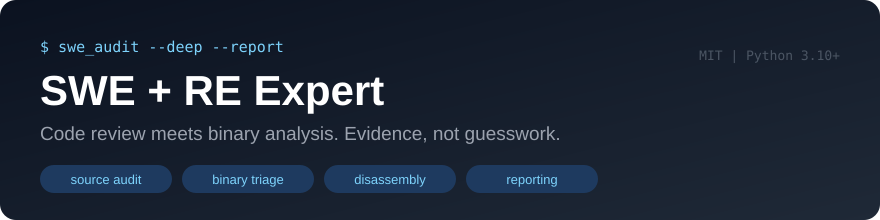
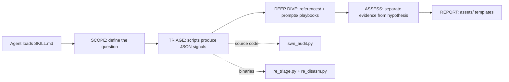

<div align="center">

[](LICENSE)
[](https://www.python.org/)
[](https://github.com/ibrdot/swe-re-expert/actions/workflows/ci.yml)
[](https://github.com/ibrdot/swe-re-expert/stargazers)
[](CONTRIBUTING.md)



A comprehensive, evidence-driven toolkit for **Software Engineering (SWE), Reverse Engineering (RE), AI coding agents, and binary analysis**. Explore 941 indexed AI agent skill guides, reusable expert prompts, practical tool integrations, source-code review workflows, and Capstone-powered disassembly. Includes a versioned JSON API, a lightweight light-mode web explorer, and a developer-friendly architecture built for extensibility.

**Built for** software engineers, reverse engineers, security researchers, AI agent developers, code auditors, and technical learners looking for a unified collection of expert skills, prompts, and tools.

**Tech Stack:** Python 3.10+ · Capstone · JSON API · AI Agent Skills · MIT License


### Evidence, not guesswork.

Audit source code, understand binaries, and turn observations into reports
you can actually verify - plus a bundled library of 941 AI agent skill guides.

[Get started](docs/GETTING_STARTED.md) · [See a real example](examples/REPORT.md) · [Capabilities](docs/CAPABILITIES.md) · [Contribute](CONTRIBUTING.md)

**Built by ibrdot** · **Contact: [ibrdot@outlook.com](mailto:ibrdot@outlook.com)**

</div>

---

## 📚 Built-in skills library (941 guides)

This repository now bundles a complete AI-agent skills library in
[`skills-library/`](skills-library/README.md): 941 indexed guides across engineering,
research, browser automation, documents, workspace workflows, and integrations.

- Full catalogue: [`skills-library/SKILLS.md`](skills-library/SKILLS.md)
- Versioned JSON API: [`skills-library/API.md`](skills-library/API.md)
- Searchable explorer (pure white, light-only): `skills-library/docs/`
- Rebuild docs and API anytime: `cd skills-library && python3 tools/build.py`

## 🧓 Contents

- [Built-in skills library](#-built-in-skills-library-941-guides)
- [Why this exists](#-why-this-exists)
- [Try it in 60 seconds](#-try-it-in-60-seconds)
- [What's included](#-whats-included)
- [Repository structure](#-repository-structure)
- [Binary analysis quick start](#-binary-analysis-quick-start)
- [The analysis loop](#-the-analysis-loop)
- [Development and testing](#-development-and-testing)
- [Troubleshooting](#-troubleshooting)
- [Security](#-security)
- [Contributing, license, roadmap](#-contributing-license-and-roadmap)
- [Help it reach the right people](#-help-it-reach-the-right-people)

## 🎯 Why this exists

A useful analysis should tell you **what was observed, where the evidence is,
what remains uncertain, and what to do next**. This skill gives your agent a
repeatable workflow for both sides of the problem: source code and compiled code.

- **Review source:** map a codebase, find complexity hotspots, examine dependencies,
  and prioritize changes instead of generating a wall of nitpicks.
- **Understand binaries:** collect static triage signals, inspect ELF/PE disassembly,
  and reason about behavior with offsets and instructions as evidence.
- **Make findings reviewable:** use four report templates with evidence, severity,
  limitations, and the smallest useful next step.

**It's a skill + supporting scripts, not an autonomous scanner or a replacement
for Ghidra, IDA, a debugger, or human verification.**

## 🚀 Try it in 60 seconds

The source-code demo needs only Python 3.10+ and Git. No account or API key.

```sh
git clone https://github.com/ibrdot/swe-re-expert.git
cd swe-re-expert
python3 scripts/swe_audit.py --root examples/demo-project --all --out /tmp/demo-audit.json
python3 -m json.tool /tmp/demo-audit.json
```

You will get a file inventory, complexity hotspots, low-reference-count candidates,
and heuristic refactor priorities. Compare with the [committed output](examples/demo-audit.json)
and [annotated report](examples/REPORT.md). These signals are leads, not confirmed vulnerabilities.

### Use it with your agent

For an agent that supports a skill folder, load this repository's **[SKILL.md](SKILL.md)**
and follow its relative references. For Claude Code's user-level skill directory:

```sh
mkdir -p "$HOME/.claude/skills"
git clone https://github.com/ibrdot/swe-re-expert.git "$HOME/.claude/skills/swe-re-expert"
```

If that destination already exists, update it rather than cloning over it.
For Codex, Cursor, or another agent, follow that product's supported instructions
for skill loading; this repo does not ship a universal installer or `.skill` release.

<details>
<summary><strong>Try these prompts</strong></summary>

```text
Use swe-re-expert to audit this repository. First map the architecture,
then identify the three highest-impact findings. Cite files and lines,
separate evidence from hypotheses, and recommend the smallest safe fix.
```

```text
Use swe-re-expert to triage this ELF binary without executing it.
Report hashes, sections, imports, and suspicious signals. Explain what
static analysis can and cannot establish. Do not infer intent from an API name.
```

```text
Explain this disassembly. Recover the calling convention, inputs,
control flow, and likely pseudocode. Cite instructions and flag ambiguity.
```

</details>

## 📦 What's included

| Component | What you get |
| --- | --- |
| [SKILL.md](SKILL.md) | Five-phase scope -> triage -> deep dive -> assess -> report workflow |
| [references/](references/) | SWE, binary analysis, malware analysis, and language playbooks |
| [prompts/](prompts/) | On-demand reasoning patterns and focused analysis playbooks |
| [scripts/](scripts/) | Three standalone Python tools producing JSON |
| [assets/](assets/) | Four Markdown report templates |
| [examples/](examples/) | Small offline fixture, actual output, and annotated report |
| [evals/](evals/) | Agent evaluation prompts, not a benchmark score |

## 🗂 Repository structure

```text
swe-re-expert/
├── SKILL.md                  # Agent entry point: five-phase workflow
├── prompt.txt                # Full agent prompt with execution logic
├── scripts/                  # swe_audit.py, re_triage.py, re_disasm.py, sync_library_site.py
├── references/               # Deep playbooks: SWE, binary, malware, language depth
├── prompts/                  # Reasoning patterns: mental-models, meta, swe/re playbooks
├── assets/                   # Four Markdown report templates
├── examples/                  # Offline demo project, committed output, annotated report
├── evals/                    # Agent evaluation prompts
├── tests/                    # Regression tests for the scripts
├── docs/                     # Getting started, capabilities, launch kit, site assets
├── skills-library/           # Bundled 941-guide library with JSON API and web explorer
├── CONTRIBUTING.md · SECURITY.md · ROADMAP.md · LICENSE
```

How the pieces connect:



The scripts are evidence collectors; the playbooks are the reasoning layer; the
templates make the output reviewable. The bundled library extends coverage to
941 additional agent skills.

## 🔍 Binary analysis quick start

```sh
python3 -m venv .venv
. .venv/bin/activate
python3 -m pip install -r requirements.txt

# Linux example: static inspection of an existing system binary
python3 scripts/re_triage.py --file /bin/ls --all --out /tmp/triage.json
python3 scripts/re_disasm.py --file /bin/ls --entry --out /tmp/disasm.json
```

| Tool | Actual scope |
| --- | --- |
| `swe_audit.py` | Source inventory; Python AST complexity; heuristic complexity for other languages; reference-count and layer-dependency candidates |
| `re_triage.py` | PE/ELF static triage; partial Mach-O support through platform tools; hashes, strings, entropy, imports, security signals |
| `re_disasm.py` | Capstone-backed ELF/PE disassembly; function discovery depends on symbols/exports |

Linux tools `file` and `readelf` improve metadata/fallbacks. Mach-O paths use
`otool` on macOS. `ssdeep` is optional. See [capability limits](docs/CAPABILITIES.md).
The scripts do not execute the target; the broader playbooks discuss tools that
must be configured separately.

## 🔁 The analysis loop

```text
SCOPE -> TRIAGE -> DEEP DIVE -> ASSESS -> REPORT
  |         |          |          |         |
question   map      evidence    priority   next step
```

Core guidance focuses on C/C++, assembly, Python, Go, and Rust. Other languages
have inventory/heuristic support or playbook coverage; that is not equivalent to
full semantic analysis of every language.

## 🛠 Development and testing

```sh
python3 -m unittest discover -s tests -v
python3 -m py_compile scripts/*.py
```

CI runs regression tests and Linux binary smoke tests. Passing these tests does
not validate all agent-generated reports or prove cross-platform parity.
[Contributions](CONTRIBUTING.md) with a small reproducer are especially welcome.

## 🔧 Troubleshooting

| Symptom | Likely cause | Resolution |
| --- | --- | --- |
| `ModuleNotFoundError: capstone` | Disassembly used without installing requirements | `python3 -m pip install -r requirements.txt` |
| `re_disasm.py` finds few functions | Target binary is stripped (no symbols/exports) | Function discovery depends on symbols; inspect with `readelf -s` first |
| Mach-O triage returns partial data | Mach-O support goes through platform tools | Run on macOS with `otool` available, or use a dedicated RE tool |
| `swe_audit.py` reports low-reference "dead code" | Heuristic; regex-based check can false-positive | Treat as a lead; confirm with call-graph or runtime evidence |
| Audit output looks empty | `--root` path not found (bug fixed in commit `255d235`) | Re-clone or update; verify the path prints in the inventory |

## 🔐 Security

The scripts perform **static** analysis only - they never execute the target file.
For reporting security issues, see [SECURITY.md](SECURITY.md). When analyzing
untrusted binaries, keep them on an isolated system and treat every string,
import, and section name as data, not instructions.

## 🌟 Help it reach the right people

If this saved you time, star the repository and share a concrete result: the
input, a useful finding, and how you verified it. Have a better workflow or a
counterexample? Open an issue. Reproducible examples beat hype.

[Launch copy and demo plan](docs/LAUNCH_KIT.md) · [Roadmap](ROADMAP.md) · [Security contact](SECURITY.md)


## 🤝 Contributing, license, and roadmap

Contributions with a small reproducer are welcome - see [CONTRIBUTING.md](CONTRIBUTING.md).
For planned work, see [ROADMAP.md](ROADMAP.md). Everything is released under the
[MIT License](LICENSE), with per-guide licensing in the bundled library documented
in [`skills-library/THIRD_PARTY_NOTICES.md`](skills-library/THIRD_PARTY_NOTICES.md).

**Author:** ibrdot · **Email:** [ibrdot@outlook.com](mailto:ibrdot@outlook.com)
**License:** [MIT](LICENSE)
